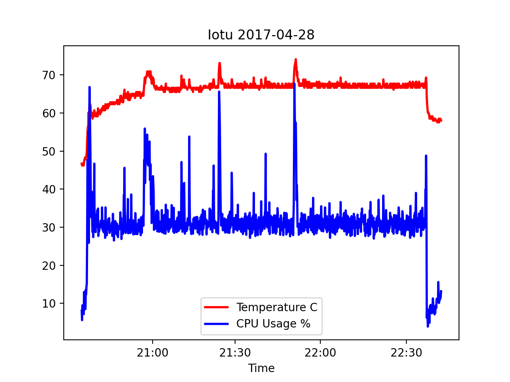
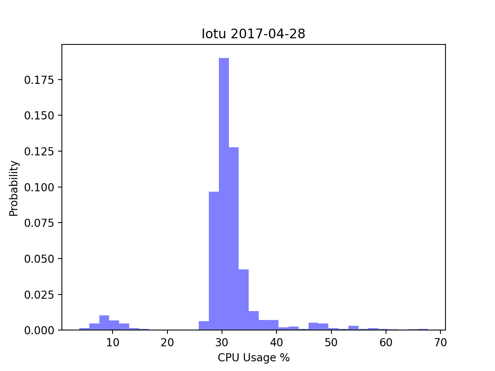
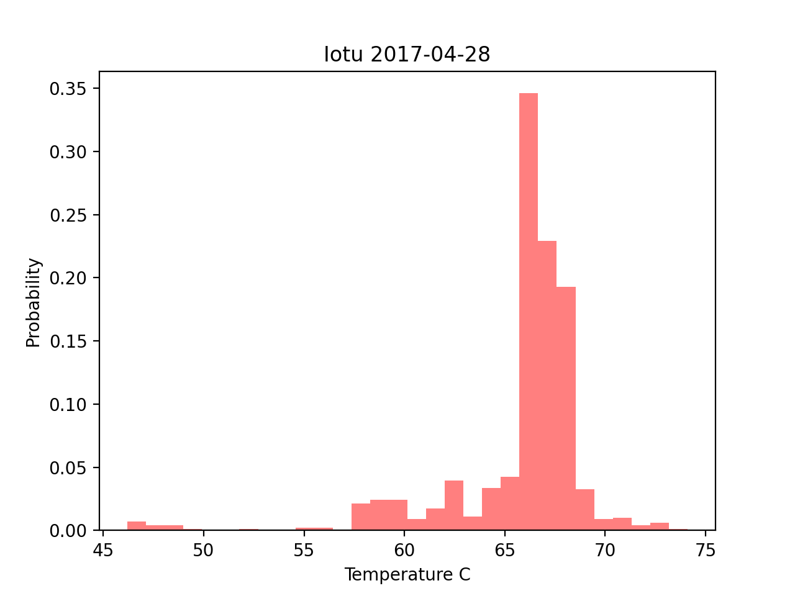
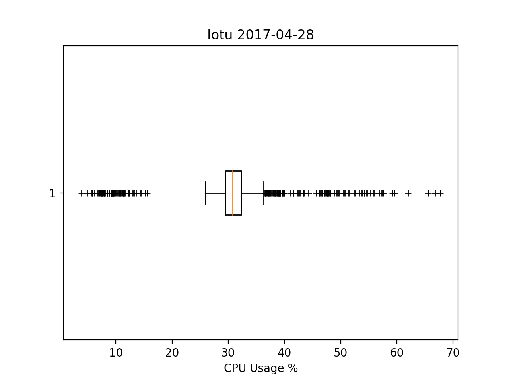
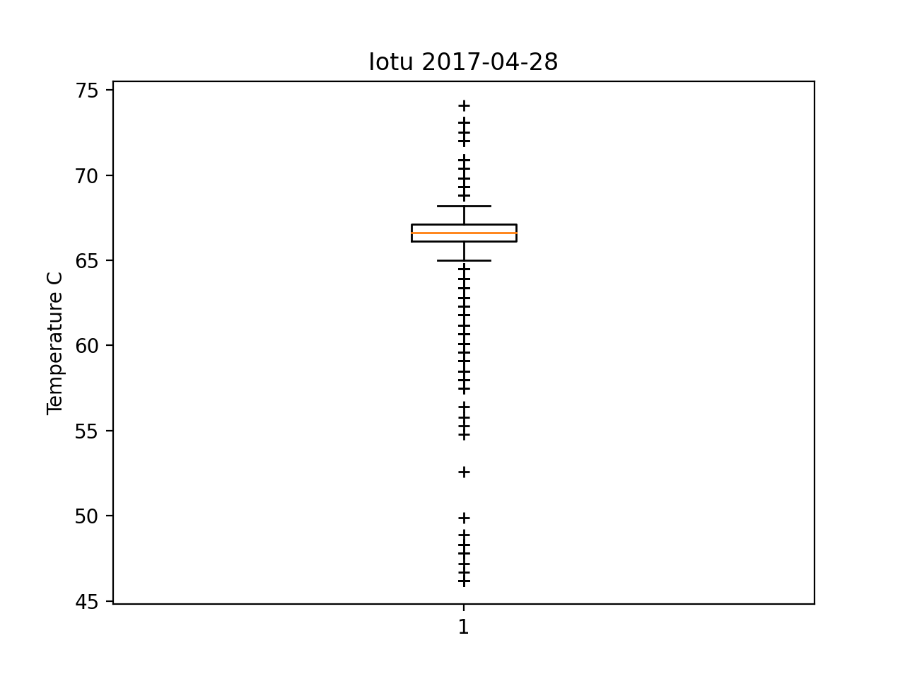
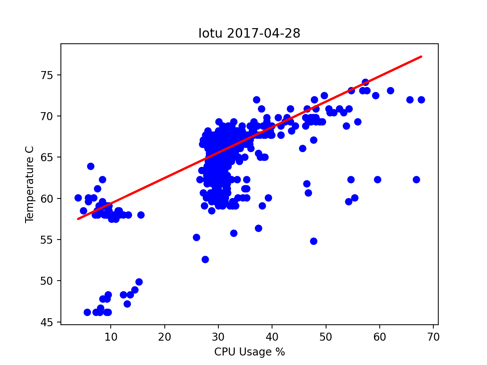
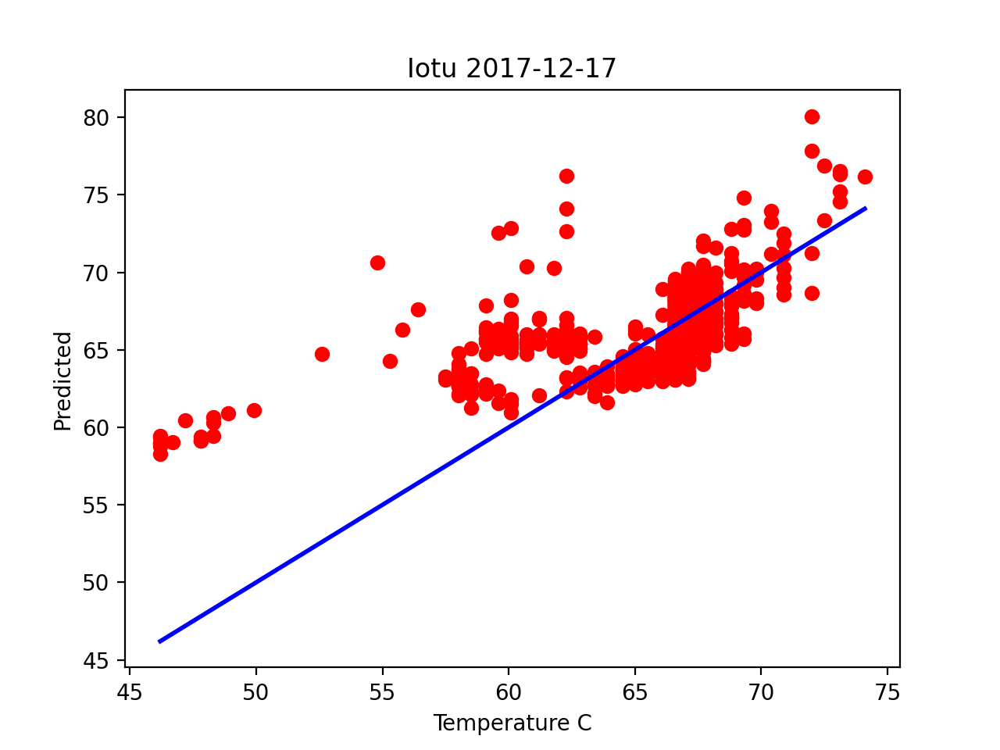

# Lesson 8: Data Analysis
* [W. Timothy Garvey](https://en.wikipedia.org/wiki/W._Timothy_Garvey), Professor and Chair, Department of Nutrition Sciences, University of Alabama at Birmingham
  > Knowledge is telling the past. Wisdom is predicting the future.
* [Data analysis](https://en.wikipedia.org/wiki/Data_analysis)
* [Committee of Presidents of Statistical Societies](https://en.wikipedia.org/wiki/Committee_of_Presidents_of_Statistical_Societies) (COPSS)
  * [COPSS Presidents' Award](https://en.wikipedia.org/wiki/COPSS_Presidents'_Award)
  * [International Prize in Statistics](https://en.wikipedia.org/wiki/International_Prize_in_Statistics)
* [Apache Hadoop](https://en.wikipedia.org/wiki/Apache_Hadoop)
* [Apache Parquet](https://en.wikipedia.org/wiki/Apache_Parquet)
* [Big data](https://en.wikipedia.org/wiki/Big_data)
* [Data annotation](https://en.wikipedia.org/wiki/Data_annotation)
  * [Surge AI](https://en.wikipedia.org/wiki/Surge_AI)
* [Data lake](https://en.wikipedia.org/wiki/Data_lake)
* [Data science](https://en.wikipedia.org/wiki/Data_science)
  * [Statistics](https://en.wikipedia.org/wiki/Statistics)
  * [Post hoc analysis](https://en.wikipedia.org/wiki/Post_hoc_analysis)
* [Data Prep Kit](https://developer.ibm.com/components/data-prep-kit/) (DPK)
  * [GitHub repository](https://github.com/data-prep-kit/data-prep-kit)
* [Diagnosis](https://en.wikipedia.org/wiki/Diagnosis)
* [Prognostics](https://en.wikipedia.org/wiki/Prognostics)
* [Kaggle](https://www.kaggle.com/)
  * [Kaggle API](https://github.com/Kaggle/kaggle-api)
* [Google Dataset Search](https://datasetsearch.research.google.com/)
* [Google Books Ngram Viewer](https://books.google.com/ngrams)
* [Culturomics](https://en.wikipedia.org/wiki/Culturomics)
* [IEEE DataPort](https://ieee-dataport.org/)
* [Datasets](https://github.com/kevinwlu/iot/tree/master/lesson8/datasets)
* [Ground truth](https://en.wikipedia.org/wiki/Ground_truth)
* [Surrogate model](https://en.wikipedia.org/wiki/Surrogate_model)
* [Surrogate data](https://en.wikipedia.org/wiki/Surrogate_data)
* [Synthetic data](https://en.wikipedia.org/wiki/Synthetic_data)
  * [Symage](https://www.symage.ai/) by [Geisel Software](https://geisel.software/)
* [Controlled Unclassified Information](https://en.wikipedia.org/wiki/Controlled_Unclassified_Information) (CUI)
* [DeepWiki](https://deepwiki.com/)
* [Code.org](https://en.wikipedia.org/wiki/Code.org)
* [Metadata](https://en.wikipedia.org/wiki/Metadata)
* [FAIR data](https://en.wikipedia.org/wiki/FAIR_data)
* [FAIRsharing](https://fairsharing.org/)

## NumPy
* [NumPy](https://en.wikipedia.org/wiki/NumPy)
* [Linear algebra](https://en.wikipedia.org/wiki/Linear_algebra)
* [Automatically Tuned Linear Algebra Software](https://en.wikipedia.org/wiki/Automatically_Tuned_Linear_Algebra_Software) (ATLAS)
* [Basic Linear Algebra Subprograms](https://en.wikipedia.org/wiki/Basic_Linear_Algebra_Subprograms) (BLAS)
* [Quickstart](https://numpy.org/devdocs/user/quickstart.html)
* [Random number generation](https://en.wikipedia.org/wiki/Random_number_generation)
* [CuPy](https://en.wikipedia.org/wiki/CuPy)
* [JAX (software)](https://en.wikipedia.org/wiki/JAX_(software))

## SciPy
* [SciPy](https://en.wikipedia.org/wiki/SciPy)
* [Regression analysis](https://en.wikipedia.org/wiki/Regression_analysis)
* [Correlation does not imply causation](https://en.wikipedia.org/wiki/Correlation_does_not_imply_causation)
* [Linear regression](https://en.wikipedia.org/wiki/Linear_regression)
* [Regression toward the mean](https://en.wikipedia.org/wiki/Regression_toward_the_mean)
* [Elastic net regularization](https://en.wikipedia.org/wiki/Elastic_net_regularization)
* [Lasso](https://en.wikipedia.org/wiki/Lasso_(statistics))
* [Ridge regression](https://en.wikipedia.org/wiki/Ridge_regression)
* [Interpolation](https://en.wikipedia.org/wiki/Interpolation)
* [Overfitting](https://en.wikipedia.org/wiki/Overfitting)
* [Mean](https://en.wikipedia.org/wiki/Mean)
* [Variance](https://en.wikipedia.org/wiki/Variance)
* [Analysis of variance](https://en.wikipedia.org/wiki/Analysis_of_variance) (ANOVA)
* [Simulated annealing](https://en.wikipedia.org/wiki/Simulated_annealing)
* [Tukey's range test](https://en.wikipedia.org/wiki/Tukey%27s_range_test) or Tukey's HSD (honestly significant difference) test

## Scikit-learn
* [Scikit-learn](https://en.wikipedia.org/wiki/Scikit-learn) machine learning in Python
* [Statistical classification](https://en.wikipedia.org/wiki/Statistical_classification)
* [Cross-validation](https://en.wikipedia.org/wiki/Cross-validation_(statistics))
* [Support-vector machine](https://en.wikipedia.org/wiki/Support-vector_machine) (SVM)
* [Precision and recall](https://en.wikipedia.org/wiki/Precision_and_recall)
* [F-score](https://en.wikipedia.org/wiki/F-score)
* [Boltzmann machine](https://en.wikipedia.org/wiki/Boltzmann_machine)
* [Restricted Boltzmann machine](https://en.wikipedia.org/wiki/Restricted_Boltzmann_machine)

## Matplotlib
* [Matplotlib](https://en.wikipedia.org/wiki/Matplotlib) visualization with Python
* [Data visualization](https://en.wikipedia.org/wiki/Data_visualization)
* [JoVE](https://en.wikipedia.org/wiki/JoVE), formerly *Journal of Visualized Experiments*
* [Histogram](https://en.wikipedia.org/wiki/Histogram)
* [Box plot](https://en.wikipedia.org/wiki/Box_plot)
  * [Median](https://en.wikipedia.org/wiki/Median)
  * [Interquartile range](https://en.wikipedia.org/wiki/Interquartile_range) (IQR)
  * [Outlier](https://en.wikipedia.org/wiki/Outlier)
* [Q-Q plot](https://en.wikipedia.org/wiki/Q%E2%80%93Q_plot)
* [Seaborn](https://seaborn.pydata.org/)
* [Bokeh](https://bokeh.org/)
* [Diagram](https://en.wikipedia.org/wiki/Diagram)
* [Exponential family random graph models](https://en.wikipedia.org/wiki/Exponential_family_random_graph_models) (ERGM)
* [Hypergraph](https://en.wikipedia.org/wiki/Hypergraph)
* [Sankey diagram](https://en.wikipedia.org/wiki/Sankey_diagram)

## Pandas
* [Pandas](https://en.wikipedia.org/wiki/Pandas_(software)) Python data analysis library

## Lab 8A: Examples
* [Q-engineering](https://qengineering.eu/)
  * [Install TensorFlow on Raspberry 64 OS](https://qengineering.eu/install-tensorflow-on-raspberry-64-os.html)
### On Windows with [WSL](https://docs.microsoft.com/en-us/windows/wsl/install-win10), open an Ubuntu terminal and install Python packages as follows
```sh
$ sudo pip3 install numpy scipy scikit-learn matplotlib pandas tensorflow keras
```
* Matplotlib on WSL requires an X11 server such as [VcXsrv](https://sourceforge.net/projects/vcxsrv/) or [Xming](https://sourceforge.net/projects/xming/) as documented [here](https://stackoverflow.com/questions/43397162/show-matplotlib-plots-and-other-gui-in-ubuntu-wsl1-wsl2) on Stack Overflow
* If there isn't a version that satisfies the requirement tensorflow (from versons: none) or no matching distribution found for tensorflow, turn on Developer Mode, join Windows Insider Program, upgrade Windows, install [Docker Desktop on Windows](https://docs.docker.com/docker-for-windows/install/), download a [TensorFlow Docker image](https://www.tensorflow.org/install/docker), open Windows PowerShell, and run the following commands
```sh
$ docker pull tensorflow/tensorflow
$ docker run -it tensorflow/tensorflow bash
# apt update
# apt full-upgrade
# apt install git-all
# git clone https://github.com/kevinwlu/iot.git
# pip install keras
# cd iot/lesson8
# python keras_diabetes.py
# python keras_first_network.py
# exit
```
### On macOS/Linux, open a terminal and install Python packages as follows
```sh
$ sudo pip3 install numpy scipy scikit-learn matplotlib pandas tensorflow keras
```
### On Raspberry Pi with Debian 10, open a terminal and install Python packages as follows
* [Installing TensorFlow on Debian 11](https://blog.d-and-j.net/deep-learning/2021/03/24/tensorflow-debian-11.html)
```sh
$ sudo apt update
$ sudo apt install python3-scipy
$ sudo apt install python3-matplotlib
$ sudo apt install python3-pandas
$ sudo apt install libopenblas-dev
$ sudo apt install libatlas-base-dev
$ sudo pip3 install -U numpy
$ sudo pip3 install --only-binary :all: -U scikit-learn
$ sudo pip3 install -U tensorflow
$ sudo pip3 install -U keras==2.3.1
```
### Enable [X11](https://en.wikipedia.org/wiki/X_Window_System) forwarding with [SSH -Y](http://man.openbsd.org/cgi-bin/man.cgi/OpenBSD-current/man1/ssh.1#Y) on a local computer to run an application on Raspberry Pi to forward the application display to the local computer

#### On Windows, download and install [VcXsrv](https://sourceforge.net/projects/vcxsrv/) or [Xming](https://sourceforge.net/projects/xming/), and open Git Bash
```sh
$ export DISPLAY=localhost:0
$ ssh -Y pi@xxx.xxx.xxx.xxx
```
#### On macOS, download and install [XQuartz](https://www.xquartz.org/), and open a terminal
```sh
$ ssh -Y pi@xxx.xxx.xxx.xxx
```
#### On Linux (most distributions have the X server installed), open a terminal
```sh
$ ssh -Y pi@xxx.xxx.xxx.xxx
```
### [X applications](https://packages.debian.org/sid/x11-apps)
* [Icosahedron](https://en.wikipedia.org/wiki/Icosahedron)
```sh
$ sudo apt update
$ sudo apt install x11-apps
$ cal
$ ico
$ oclock
$ xcalc
$ xclock
$ xeyes
$ xgc
$ xlogo
$ xman
```
### Numpy array
```sh
$ python3
>>> import numpy as np
>>> a = np.arange(6)
>>> a
>>> b = np.arange(12).reshape(4, 3)
>>> b
>>> c = np.arange(24).reshape(2, 3, 4)
>>> c
>>> b.shape
>>> b.reshape(-1)
>>> b.reshape(-1, 1)
>>> b.reshape(2, -1)
>>> d = np.array([20, 30, 40, 50])
>>> e = np.arange(4)
>>> f = d-e
>>> f
>>> e**2
>>> A = np.array([[1, 1], [0, 1]])
>>> B = np.array([[2, 0], [3, 4]])
>>> A*B
>>> A.dot(B)
>>> np.dot(A, B)
>>> g = np.ones((2, 3), dtype=int)
>>> g
>>> h = np.random.random((2, 3))
>>> h
>>> g *= 3
>>> g
>>> h += g
>>> h
>>> k = np.random.random((2, 3))
>>> k
>>> k.sum()
>>> k.min()
>>> k.max()
>>> m = np.arange(12).reshape(3, 4)
>>> m
>>> m.sum(axis = 0)
>>> m.min(axis = 1)
>>> m.cumsum(axis = 1)
>>> n = np.arange(5)
>>> n
>>> n[[1, 3, 4]] = 0
>>> n
>>> exit()
```
### Review and Run Python code
```sh
$ cd ~/iot/lesson8
$ python3 pyplot_simple.py
$ python3 simple_plot.py
$ python3 pyplot_formatstr.py
$ python3 ticklabels_demo_rotation.py
$ python3 pyplot_three.py
$ python3 pyplot_two_subplots.py
$ python3 pyplot_scales.py
$ python3 pyplot_annotate.py
$ python3 major_minor_demo1.py
$ python3 legend_demo.py
```

### Histograms, box plots, regression, and interpolation
```sh
$ python3 scatter_demo.py
$ python3 histogram_demo_features.py
$ python3 pyplot_text.py
$ python3 histogram_demo_extended.py
$ python3 boxplot_demo.py
$ python3 linreg.py
$ python3 interpolation.py
```

### Classification, cross-validation (CV), and support-vector machine (SVM)
```sh
$ python3 plot_lda.py
$ python3 plot_lda_qda.py
$ python3 plot_cv_predict.py
$ python3 plot_cv_diabetes.py
$ python3 traffic.py
```

### Keras and TensorFlow

[Deep learning project in Python with Keras](https://machinelearningmastery.com/tutorial-first-neural-network-python-keras/)
```sh
$ python3 keras_diabetes.py
$ python3 keras_first_network.py
```

### Titanic example
```sh
$ cp train.csv ~/demo
$ cp test.csv ~/demo
$ cp titanic_1.py ~/demo
$ cp titanic_2.py ~/demo
$ cd ~/demo
$ python3 titanic_1.py
$ python3 titanic_2.py
```

## Lab 8B: Data Analysis

### Analyze Raspberry Pi date/time and CPU usage/temperature of Lab 7B

* [Insert four charts](https://support.google.com/docs/answer/63824) including time series, two histograms, and a scatter plot with a linear trendline
* Save the Google sheet in CSV format (e.g., rpidata.csv or cpudata.csv) to ~/demo
* Copy ~/iot/lesson8/plt_final.py and plt_cv2.py to ~/demo
* Edit plt_final.py and plt_cv2.py to read the CSV file
* Show seven figures including time series, two histograms, two box plots, a scatter plot with a linear regression line, and cross-validation prediction with temperature as target
* Edit the title/labels in plt_final.py and plt_cv2.py, and add legend or adjust ticks as needed
```sh
$ cd ~/demo
$ cp ~/iot/lesson8/plt_final.py .
$ cp ~/iot/lesson8/plt_cv2.py .
$ nano plt_final.py
```
> data = read_csv('rpidata.csv')
```sh
$ nano plt_cv2.py
```
> X = read_csv('rpidata.csv', usecols=[1])

> y = read_csv('rpidata.csv', usecols=[2])
```sh
$ python3 plt_final.py
$ python3 plt_cv2.py
```














